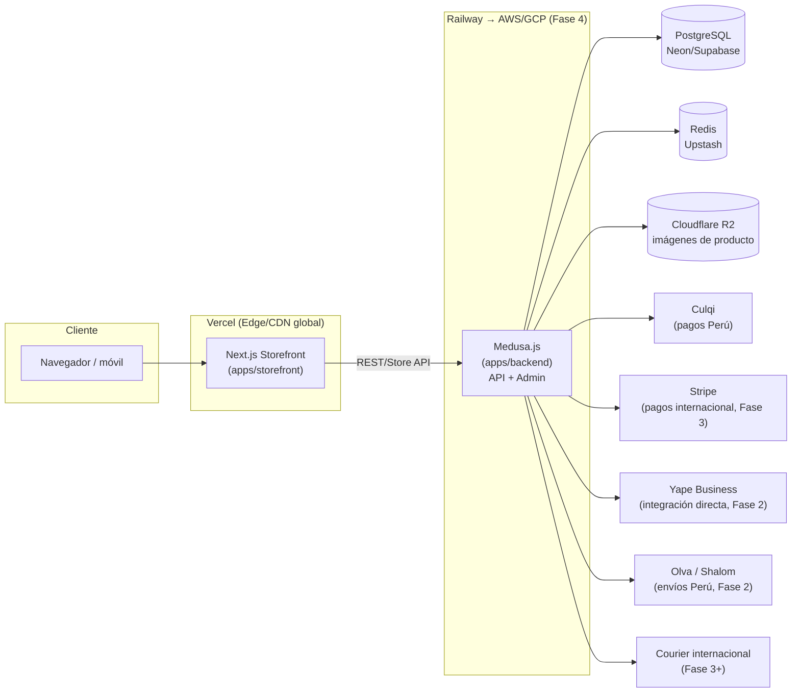

# Arquitectura técnica

## 1. Contexto y restricciones

- **Equipo:** un solo developer por ahora. El stack debe minimizar carga operativa (DevOps, mantenimiento de servidores) sin sacrificar control sobre la experiencia de compra ni sobre los datos.
- **Mercado:** lanzamiento en Perú (pagos locales, soles, Yape/tarjetas), con expansión planificada a otros países de LatAm y, luego, internacional.
- **Producto:** marca de ropa underground/motera — la identidad visual y la experiencia de la tienda (storefront) son diferenciadores clave, por lo que se descarta una plataforma "caja cerrada" (tipo Shopify no-headless) que limite el diseño.
- **Requisito no funcional principal:** la arquitectura debe soportar múltiples monedas, idiomas y métodos de pago por región sin reescribir el core del negocio — es la base para escalar de Perú a otros países.

## 2. Decisión de stack

| Capa | Elección | Alternativa considerada | Por qué |
|---|---|---|---|
| Storefront (frontend) | **Next.js 15** (React, App Router) | Remix, Nuxt | SSR/ISR para SEO, ecosistema maduro, i18n de rutas nativo, despliegue trivial en Vercel |
| Motor de comercio (backend) | **Medusa.js v2** (Node.js/TypeScript, self-hosted, MIT) | Shopify Headless (Hydrogen), Vendure | Open source y sin comisión sobre GMV; soporte nativo de **regiones** (moneda, impuestos, proveedores de pago/envío por país) pensado para escalar internacionalmente; propiedad total de los datos |
| Base de datos | **PostgreSQL** (Neon o Supabase, managed) | MySQL | Requerido por Medusa; managed Postgres da branching de DB y backups sin operar un servidor |
| Cache / event bus | **Redis** (Upstash, serverless) | — | Requerido por Medusa en producción; Upstash cobra por uso, ideal para etapa inicial |
| Pagos — Fase 1 (Perú) | **Culqi** | Niubiz, Izipay | Integración más rápida (~30 min, afiliación 1-3 días) — prioridad para lanzar el MVP rápido siendo un solo developer. Ver sección 4 |
| Pagos — Fase 3 (internacional) | **Stripe** | PayPal, MercadoPago regional | Cobertura global, soporte multi-moneda maduro, plugin oficial para Medusa |
| Almacenamiento de medios | **Cloudflare R2** (S3-compatible) | AWS S3 | Sin costos de egress, más barato para servir imágenes de producto a alto volumen |
| Hosting storefront | **Vercel** | Netlify | Integración nativa con Next.js, CDN global (relevante para expansión internacional) |
| Hosting backend (Medusa + admin) | **Railway** (Fase 1-2) → **AWS Fargate / GCP Cloud Run** (Fase 4) | Render, DigitalOcean | Railway minimiza DevOps para un solo developer; migración a contenedores gestionados cuando el volumen lo justifique |
| CI/CD | **GitHub Actions** | — | Gratuito para repos privados pequeños, se integra con Vercel/Railway |
| Monorepo | **pnpm workspaces + Turborepo** | Nx | Ligero, build cacheado, estándar en proyectos Next.js/Medusa |
| Analítica / errores | **PostHog** + **Sentry** | Google Analytics | Privacidad por diseño (relevante para cumplimiento internacional futuro tipo GDPR) |

> Cada fila de esta tabla debe registrarse como un ADR individual en [`docs/decisions/`](./docs/decisions/) a medida que se confirme o cambie.

## 3. Diagrama de arquitectura (alto nivel)

## 4. Pagos: detalle y hallazgos

Investigación de mercado (setiembre 2026) sobre las tres pasarelas líderes en Perú:

- **Comisiones:** Izipay 3.29–3.99% + IGV, Niubiz 3.45–4.19% + IGV, Culqi 3.49–4.20% + IGV. Izipay es la más barata en el papel; la diferencia real depende del volumen negociado.
- **Integración técnica:** Culqi es la más rápida de integrar (documentación simple, ~30 min para un MVP); Izipay toma 1-2 horas; Niubiz es la más compleja (medio día, requiere configuración de canal de venta).
- **Afiliación como comercio:** Culqi 1-3 días, Izipay 3-7 días, Niubiz 5-10 días.
- **Métodos soportados:** las tres cubren Visa/Mastercard; Izipay y Niubiz además Amex y Diners.
- **Yape:** ninguna de las tres pasarelas incluye Yape de forma nativa — requiere integración aparte con Yape Business. Dado que Yape es el método de pago dominante entre compradores jóvenes en Perú (el público objetivo de esta marca), se planifica como *fast follow* inmediatamente después del lanzamiento con Culqi (ver `ROADMAP.md`, Fase 2).

**Decisión:** lanzar el MVP con **Culqi** por velocidad de integración y afiliación (crítico para un solo developer que necesita salir a producción rápido), añadir **Yape** en la Fase 2, y evaluar Izipay o Niubiz como proveedor secundario solo si el volumen de ventas justifica negociar mejores comisiones.

## 5. Estrategia de internacionalización

Medusa modela cada país/mercado como una **región**: moneda, impuestos, proveedores de pago y de envío configurables de forma independiente. Esto permite:

1. Lanzar con una sola región (Perú, PEN, Culqi) sin sobre-construir.
2. Agregar regiones nuevas (ej. México, Chile) declarando configuración, no reescribiendo lógica de negocio.
3. En el storefront, usar el sistema de i18n de rutas de Next.js (`/pe/es/...`, `/mx/es/...`, `/us/en/...`) en cuanto exista una segunda región.

## 6. Seguridad y cumplimiento

- Nunca se procesan ni almacenan números de tarjeta en el backend propio — siempre mediante tokenización de la pasarela (Culqi/Stripe).
- Secrets (API keys, JWT secrets) solo en variables de entorno / secret manager del hosting, nunca en el repositorio (ver `.env.example`).
- A medida que se agreguen mercados con regulación de datos personales (ej. GDPR para UE), evaluar necesidad de anonimización/consentimiento en PostHog.
